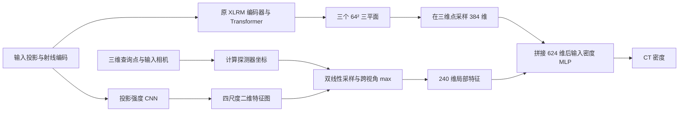

# XLRM 几何对齐的多尺度投影特征分支

当前配置将三平面点特征的 384 维，与四尺度投影特征的 240 维拼接，使用 624→128→128→128→1 的密度 MLP。训练使用 CT 点 MSE，两个分支和解码器一起更新。



## 特征与几何

- 新 CNN 独立处理每张投影，只读取原七通道输入的强度通道，保持原强度尺度。224² 输入对应的特征图为 16×224²、32×112²、64×56²、128×28²。
- 每个三维点根据同一张输入图的相机投到探测器，四个尺度分别双线性采样，跨有效视角取 max，再按尺度拼接。相机后方、探测器外和被局部分支 mask 禁用的视角不参与 max，全部无效时局部特征为零。
- 相机是现有 XLRM 的 25 个数：按行展开的 Blender `world_from_camera` 4×4，再接图像归一化的 OpenCV 内参 3×3。投影时转到 OpenCV 相机坐标。三维点与相机平移均使用 XLRM 世界单位，LNDb 中 200 mm 立方体映射到 `[-1,1]³`。
- 新分支使用常规 `(column,row)` 网格、`grid_sample(align_corners=False)` 和像素中心内参。DeepSparse 本地代码使用转置特征图及 `align_corners=True`；这里沿用 XLRM 的像素中心约定，并以原射线采样器的往返测试验证。
- 几何在 FP32 中计算，三维矩阵乘法用显式分量求和，避免本机 TF32 设置降低坐标精度。对应修改也用于原 RaySampler 的方向旋转。
- 网络输入只有投影和相机。CT 只提供损失标签。`encode()` 返回当前病例的特征与相机，评价时由调用方复用，模型不缓存跨病例的投影坐标。

这借鉴了 DeepSparse 查询二维局部特征的机制。新增模块使用独立的轻量 CNN，XLRM 的三平面路径继续提供全局特征。

## 接口和配置

`configs/train-lrm-lndb-reprojection.yaml` 开启 `model.reprojection_channels: [16,32,64,128]`，三平面各 128 通道，`point_feature_dim: null`，每例 10,000 CT 点，像素和 TV 损失为零。多患者训练配置为 200 轮，验证使用重采样 128³ CT，患者划分沿用原数据。

默认 `reprojection_channels=None` 关闭新分支，已有模型参数名和形状保持兼容。开启时 MLP 首层由 384 扩至 624，需使用新架构 checkpoint；当前入口不会自动改写旧权重。

```python
# image: [B,V,H,W,7]; input_cameras: [B,V,25]; points: [B,P,3]
output = model(image, input_cameras=input_cameras, ct_query_points=points)

# 评价时只编码一次，再分块查询。
context = model.encode(image, input_cameras)
density = model.query_points(context, points)['sigma']
```

开启分支后使用上述入口。直接调用 `forward_planes()` 只能得到三平面，不能提供二维局部特征。当前分支的训练与评价入口支持 CT 点和 CT 体积，监督保持 CT MSE。

## 已执行的验证

2026-11-21，容器 `base_cy`、环境 `ct`、GPU0：

- LNDb-0045 的矩阵投影与独立圆轨迹公式的最大归一化误差为 `5.96e-7`。
- 原射线采样器的非中心像素往返误差为 `2.38e-7`，在 224² 探测器约为 `0.000027` 像素。AMP 开关不改变几何结果。
- 像素坐标坡度图采样、全不可见点、视角同步置换、局部分支 mask、输入强度变化、分块查询和网格/点查询一致性检查通过。
- FP32 分块查询最大差为 `2.38e-7`。BF16 不同查询批量下最大差为 `0.00390625`，对应输出量化，单独记录。
- 新二维编码器、三平面上采样器和 MLP 新增输入列均有非零有限梯度。关闭分支后，旧第 5,000 步 checkpoint 严格加载，原点查询与新模型入口的预测逐元素一致。
- 正式 LNDb 训练器的单步训练及一次 32³ 验证通过，训练标签来自 LNDb-0007 的原生 CT，`projection_mse=null`。

LNDb-0045、24 视角的配对短程测试使用相同的 10,000 点/步、种子、CT MSE、AdamW 和 128³ 偶数原生坐标留出网格。两组均随机初始化，全参数训练；新增分支改变了 MLP 首层结构与初始化。预测裁剪到 `[0,1]`，固定强度范围 1。

| 模型 | 起点 PSNR / dB | 50 步 PSNR / dB | 100 步 PSNR / dB | 100 步 3D SSIM |
|---|---|---|---|---|
| 原 384 维 XLRM | 6.7192 | 12.7827 | 17.4510 | 0.3467 |
| 384+240 维重投影分支 | 7.0893 | 12.0433 | 21.1301 | 0.5350 |

100 步差值为 +3.6791 dB。这是单病例早期拟合结果。新增模型的 5,000 步成绩和多患者泛化待运行。

另外从新增模型第 100 步完整状态恢复，单独追加 1 步验证恢复入口，累计第 101 步为 21.1666 dB。恢复起点逐体素预测一致。此诊断保存在独立目录，未并入上表的 100 步成绩。

宿主机证据目录位于 `/data/wangcy/experiment/sasplat/results/XLRM/`：

- `lndb0045_reprojection_check_20261121/`：`checks.json`、`fit_comparison.json`、`comparison_100.png`、`trainer_smoke/smoke.json` 及各验证日志。
- `lndb0045_reprojection_scratch100_20261121/`：新增分支的 100 步实验。
- `lndb0045_reprojection_control100_20261121/`：关闭分支的 100 步配对对照。
- `lndb0045_reprojection_resume101_check_20261121/`：累计 101 步的恢复诊断。

## 服务器命令

从宿主机执行几何与梯度检查：

```bash
docker exec -e CUDA_VISIBLE_DEVICES=0 -e TORCHDYNAMO_DISABLE=1 \
  -e PYTHONPATH=/workspace/recon/X_videoDiffusion -e OMP_NUM_THREADS=4 \
  -w /workspace/recon/X_videoDiffusion base_cy /opt/conda/envs/ct/bin/python \
  -m tools.check_reprojection \
  --config configs/train-lrm-lndb-reprojection.yaml \
  --dataset-root /data/experiment/sasplat/lndb \
  --legacy-checkpoint /data/experiment/sasplat/results/single_case/lndb0045_24views_resume5000_20261121/xlrm384/step5000.pth \
  --output /data/experiment/sasplat/results/XLRM/lndb0045_reprojection_check_20261121/checks.json
```

以下命令可从已保存的第 100 步继续至累计 5,000 步，每 500 步评价；尚未执行这次长期训练。输出目录需不存在。

```bash
docker exec -e CUDA_VISIBLE_DEVICES=0 -e TORCHDYNAMO_DISABLE=1 \
  -e PYTHONPATH=/workspace/recon/X_videoDiffusion -e OMP_NUM_THREADS=4 \
  -w /workspace/recon/X_videoDiffusion base_cy /opt/conda/envs/ct/bin/python -u \
  -m tools.fit_wide_point_features \
  --config configs/train-lrm-lndb-reprojection.yaml \
  --dataset-root /data/experiment/sasplat/lndb \
  --e13-root /data/experiment/sasplat/results/single_case/lndb0045_24views_scratch_1000_20261120 \
  --output /data/experiment/sasplat/results/XLRM/lndb0045_reprojection_resume5000_20261121 \
  --direct-features --reprojection --steps 5000 --eval-every 500 \
  --resume /data/experiment/sasplat/results/XLRM/lndb0045_reprojection_scratch100_20261121/step100.pth
```

宿主机 `/data/wangcy` 挂载为容器 `/data`，`/home/wangcy/projects` 挂载为 `/workspace`。普通多患者训练可在新的输出工作目录中运行 `python -m x_ggrm.runners.train.lndb_lrm --config /workspace/recon/X_videoDiffusion/configs/train-lrm-lndb-reprojection.yaml`；以上两类完整训练均尚未执行。
